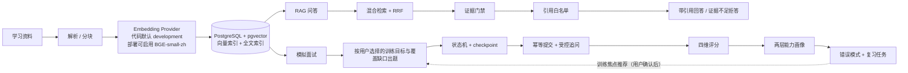

# 00 面试突击总览

> **怎么用**：面试前 20 分钟朗读一遍，重点是 §1、§4、§8。
> 只剩 10 分钟：只读 §1（口述脚本）、§5（状态表）、§8（红线卡）。
> **配套**：要讲完整链路和定位代码去读 `01`；被追问时的故事与弹药去读 `02`。
> **原文**：`docs/interview/` 下 11 份原始材料完全保留，作为证据库，不作突击阅读入口。

**状态标记（全文通用）**

| 标记 | 含义 |
|---|---|
| 🟢 **ON** | 已实现且默认启用，用户可用 |
| 🟡 **OFF** | 已实现但默认关闭 / 仅用于评测（eval-only） |
| ⚪ **TODO** | 未实现，只作为演进方向，**不能说成已有能力** |

**代码引用格式（全文通用）**：`文件路径 → 类/函数 → 作用`。不写行号，便于 IDE 跳转与口述。

---

## 1. 口述脚本

### 1.1 三十秒版（背下来）

> AgentMentor 是一个面向「Java 后端转 AI Agent 开发」的个人 AI 面试训练系统。
> 它把学习资料变成**可检索、可引用的证据**，用这些证据支撑两条路径：RAG 问答回答"资料能不能答"，模拟面试回答"我到底会不会"。
> 面试产生的**可信评分**会沉淀成两层能力画像、错误模式和复习任务；系统据此推荐训练焦点，再由用户确认后用于下一轮选题，形成闭环。
> 整套系统可以在 16GB 普通开发机上用 Docker Compose 跑通，无 GPU；LLM 相关链路都设计了明确的降级路径，没有模型 Key 也能演示核心闭环，但效果不等同真实模型模式。

### 1.2 两分钟版（在三十秒版基础上加四段）

**第一段 · 技术形态**
> 后端是 FastAPI + PostgreSQL/pgvector 的模块化单体，按 API、Application、Domain、Ports、Infrastructure 分层：API 只做协议与参数校验；Application Service 是真正的编排中心，负责事务、幂等和降级；Domain 层是纯函数规则，不依赖任何框架；Ports 用 Protocol 声明 LLM、Embedding、检索的契约；Infrastructure 实现这些契约，包括数据库访问、LLM 网关和 Embedding 适配器。前端是 React 工作台，只做展示，不承载唯一业务真相。

**第二段 · 两条消费路径的区别**
> 这两条路径的差别是我设计时最在意的一点。RAG 问答的目标是"这份资料能否回答当前问题"，所以它的核心约束是**证据充分性和引用可追溯**，证据不足要敢拒答。
> 模拟面试的目标是"用户是否真的掌握资料内容"，所以它的核心约束是**状态可恢复和评分可信**：题目、参考答案、Rubric 要落库，评分不能由模型决定最终分数，低置信结果不能污染长期画像。

**第三段 · 三个我觉得最值得讲的设计**
> 第一，可信 RAG：不是检索分高就回答，而是先判断候选片段是否真的支持问题，生成后还要过引用白名单，不满足就降级或拒答。
> 第二，受控面试工作流：三题面试跨越多次请求，必然有人机中断，所以每步写 checkpoint，答案提交带幂等键并由数据库唯一约束兜底，追问也由门禁规则控制而不是模型自主决定。
> 第三，评测与失败候选治理：我用冻结数据集和预声明门槛做验收，有几个候选拿到局部收益但没过独立验收，我选择了**不上线**，并且把失败结论和证据保留下来。

**第四段 · 边界**
> 它现在是个人学习训练系统，不是企业级平台。几个我必须说清的边界在 §4。

### 1.3 它不是什么的对照表

| ❌ 不是 | ✅ 而是 |
|---|---|
| 调个 API 聊天的 Demo | 有状态、有规则、有长期记忆的训练系统 |
| 通用 ChatGPT 替代品 | 把大模型包装成受领域证据约束的训练应用 |
| LangGraph 运行时 | 自己实现显式节点 + checkpoint 的人机工作流 |
| 企业多租户平台 | 模块化单体，本机单用户优先 |
| 真实招聘评价系统 | 只用于个人学习，不代表正式招聘结论 |

---

## 2. 主链路全景图



> 注意：图里写的是 **Embedding Provider**，不是写死 BGE。代码默认是 `development`，标准部署通过 `.env` 启用 BGE，实际生效的以 `/health/runtime` 为准（见 §4 第 1 条）。

---

## 3. 三个最强亮点

每点按「一句话 → 机制 → 怎么证明」讲。

### 亮点一 · 可信 RAG（🟢 ON）

- **一句话**：我把"检索分高"和"证据真能支持问题"拆成两件事，回答必须站在能追溯的证据上。
- **机制**：混合检索（全文 + 向量 + RRF 融合）拿到候选后，先做**证据充分性判定**——候选片段必须与问题有词面支持，且受支持候选的最高分要达到阈值；生成后再过**引用白名单**，模型只能引用本次检索上下文里的 chunk，编造引用直接降级；证据不足时明确拒答，而不是把模型常识伪装成资料结论。
- **怎么证明**：有两条用例直接钉住这个边界——"向量分高但无词面支持的片段不能算有效证据"、"模型返回不在上下文里的 chunk_id 时降级为确定性回答"。
- **代码**：`src/agent_mentor/application/answer_service.py` → `AnswerService.assess_evidence_diagnostics()` → 证据判定与诊断；`src/agent_mentor/rag/retrieval.py` → `validate_citations()` → 引用白名单校验。

### 亮点二 · 受控面试工作流（🟢 ON）

- **一句话**：面试是跨多次请求的有状态流程，我显式实现了节点、中断、恢复和幂等，而不是把它当成三次函数调用。
- **机制**：创建 → 启动（写 `load_profile`、`plan_interview` checkpoint）→ 出题（带 Rubric 与覆盖查漏）→ **人机中断等待回答** → 幂等提交 → 受控追问（每题最多一次，且要过回答质量门禁）→ 推进或结束。关键状态转换写入 append-only checkpoint；答案提交用 `Idempotency-Key` 加数据库唯一约束双保险，并发和网络重试都不会重复推进。
- **怎么证明**：幂等有测试覆盖"同一题相同幂等键只保存一次"；工作流轨迹可通过接口回放，刷新页面能恢复当前题。
- **代码**：`src/agent_mentor/api/interviews.py` → 提交答案入口；`src/agent_mentor/application/interview_service.py` → `InterviewService.submit_answer()` → 状态推进与幂等；`src/agent_mentor/domain/interview.py` → `ALLOWED_STATUS_TRANSITIONS` → 状态机合法迁移。

### 亮点三 · 评测与失败候选治理（🟢 ON / 结论是"不上线"）

- **一句话**：我不只做了评测，还真的用评测**拒绝过候选**——这比多上一个功能更能说明工程判断。
- **机制**：冻结数据集 + 预声明硬门槛 + 独立验收集，候选必须一次性通过；不通过就停止，不降门槛、不针对验收集调参。
- **怎么证明**：三个候选有局部收益但没过验收，我选择关闭并把失败报告留档（详见 `02` 和 §6）。
- **代码/证据**：`evals/run.py`、`docs/evaluations/`、`docs/decisions/` → ADR-002 / ADR-003 / ADR-004。

---

## 4. 三条关键边界（必须主动说，不要等面试官挖出来）

| # | 边界 | 准确表述（照着说） | 依据 |
|---|---|---|---|
| 1 | Embedding 默认 | "代码层默认 provider 是 `development`（确定性 feature hash）；标准部署在 `.env` 里显式设为 `bge`，用本地 BGE-small-zh；实际生效的看 `/health/runtime`。" | `src/agent_mentor/config.py` → `Settings.embedding_provider`；`.env.example`；`src/agent_mentor/main.py` → 按 provider 装配 |
| 2 | 流式输出 | "面试和问答的流式**目前是伪流式**——先拿到完整内容再切分推送，还没有实现真正的 SSE 逐 token 推流。这是明确的待办。" | `src/agent_mentor/infrastructure/llm.py` → `stream_text()`（实现内注释即说明非真流式） |
| 3 | 实验线未上线 | "Shadow Agent、Relation-Value V3、用户触发二阶段检索都已经实现或验证过，但**全部没有接入生产链路**，feature flag 默认关闭。保留的是基础设施和失败结论。" | `src/agent_mentor/config.py` → `shadow_agent_enabled`、`retrieval_expansion_enabled` 默认 `false`；`docs/decisions/` → ADR-002 / ADR-003 / ADR-004 |

---

## 5. 状态表（核心 10 项）

> 用途：被问"这个到底上线了吗"时，一眼给出准确状态。

| 能力 | 状态 | 依据 |
|---|---|---|
| 混合检索 + RRF + 每文档配额 3 | 🟢 ON | `src/agent_mentor/config.py` → `Settings.retrieval_*` |
| Evidence Gate（`current_binary_v1`） | 🟢 ON | `src/agent_mentor/config.py` → `Settings.evidence_gate_policy` |
| 引用白名单 + 证据不足拒答 | 🟢 ON | `src/agent_mentor/application/answer_service.py` → `assess_evidence_diagnostics()`；`src/agent_mentor/rag/retrieval.py` → `validate_citations()` |
| 面试状态机 + checkpoint + 答题幂等 | 🟢 ON | `src/agent_mentor/application/interview_service.py` → `submit_answer()`；`src/agent_mentor/domain/interview.py` → `ALLOWED_STATUS_TRANSITIONS` |
| 受控追问（每题最多一次） | 🟢 ON | `src/agent_mentor/application/interview_service.py` → `_maybe_create_follow_up()`；模型 `InterviewFollowUpModel` |
| 四维评分 + 应用层重算总分 + 复核路由 | 🟢 ON | `src/agent_mentor/application/evaluation_service.py`；`src/agent_mentor/domain/evaluation.py` → `total_score()` |
| 两层画像 + 复习任务（自动验证连续两次） | 🟢 ON | `src/agent_mentor/application/profile_service.py` → `apply_interview_evaluations()`；`src/agent_mentor/domain/profile.py` → `review_verification_progress()` |
| Evidence Gate 二级策略（`clause_demand_v1`） | 🟡 OFF | `src/agent_mentor/domain/evidence.py` → `EvidenceGatePolicy`（已实现，非默认） |
| 每文档配额 4：eval-only 候选 | 🟡 OFF | 曾改善特定消融指标，但未成为默认策略 |
| Shadow Agent V2 / Relation-Value V3 / 二阶段检索 | 🟡 OFF（eval-only） | `docs/decisions/` → ADR-002 / ADR-003 / ADR-004 |
| 真 SSE 流式 / LLM tool-calling / 可靠任务队列 | ⚪ TODO | `src/agent_mentor/infrastructure/llm.py` → `stream_text()` 为伪流式；`src/agent_mentor/` 下尚无 `agent` 子模块 |

---

## 6. 五个必记数字

> **记住顺序是"数字 → 它证明了什么决策"，不要在面试里主动倒数字。** 完整指标表在 `02` 的证据索引。

| 数字 | 它证明了什么 | 来源 |
|---|---|---|
| vector-only：Recall@6 **70.59%** / MRR **48.53%** | 在冻结数据上，最简单的基线就是最强头部排序；加 RRF 并没有让 Recall@6 变好，所以"组件越多越好"是错的 | `docs/evaluations/evidence-gate-claim-evaluation-20260929.md` §2.1 |
| 损失漏斗：candidate@20 **88.24%** → post-filter@6 **70.59%** | 漏召回不是排序问题，而是**每文档过滤**丢的（5 个 miss 里 3 个死在过滤阶段）→ 所以我去做配额消融，而不是调 RRF 权重 | 同上 §2.1 |
| Relation-Value V3 正例 demand recall **6.45%** | 负例拒绝 100% 很漂亮，但正例几乎绑不上 → **"安全但不可用"**，拒绝上线 | `docs/evaluations/relation-value-v3-acceptance-20261004.md` |
| 二阶段检索固定消费 precision **1.9%** | 补充通道能把召回补回来（Development 补回 6/6 miss），但自动消费的精度远低于 0.30 门槛 → 不接生成链路 | `docs/decisions/ADR-003-阶段性关闭二阶段检索生产接入.md` |
| Shadow Agent V2 真实模型正常完成率 **41.67%** | 首路由/动作 100% 是**确定性 fallback 导出的**，不是模型决策成功 → 真实模型不稳定，关闭实验线 | `docs/evaluations/shadow-agent-v2-development-20261005.md` |

---

## 7. 代码定位五件套（极简示例）

> `01` 里每条链路都会有完整的五件套卡片；这里先给一个示例，让你熟悉**口述时的定位句式**。
> 五件套 = **入口 API → 编排 Service → 核心领域规则 → 关键持久化模型 → 出问题先看哪里**。

### 示例：面试里"同场追问没有生成"

```text
入口 API：       src/agent_mentor/api/interviews.py → POST /interviews/{id}/answers
编排 Service：   src/agent_mentor/application/interview_service.py → InterviewService.submit_answer()
核心决策：       interview_service.py → _maybe_create_follow_up()
关键持久化模型： InterviewFollowUpModel
出问题先看：     should_follow_up 是否成立、confidence 是否达门槛、会话状态是否 WAITING_FOR_ANSWER
```

**口述示范（被问到实现时照这个说）**：

> 这部分我会先从 `src/agent_mentor/api/interviews.py` 的提交答案入口进来，编排逻辑在 `InterviewService.submit_answer()`：它先做幂等查重和状态校验，再决定是否推进。真正决定要不要创建追问的是 `_maybe_create_follow_up()`，只有回答质量门禁通过、置信度达阈值、且该题还没有追问时才会创建；持久化模型是 `InterviewFollowUpModel`，唯一约束保证每题最多一条。如果现场发现没生成追问，我会按这个顺序排查：状态是不是 `WAITING_FOR_ANSWER`、门禁是否通过、唯一约束是否已存在记录。

这个句式的价值：**你不需要假装背过每一行代码，但能证明你掌握架构、关键路径、边界和排查方式。**

### 7.1 关于"代码是不是你写的"（被问到就照这个说）

> 我主导了问题定义、架构边界、关键策略和验收标准；实现阶段借助 AI 提升效率，但我会对关键链路做源码走读、验证测试和运行态核对。比如追问链路，我能从 API 入口定位到 Service 编排、门禁决策、状态约束与持久化模型，并解释为什么这样设计。

**不要这样说**：不要说"代码全部是我手写的"，也不要说"AI 写的我不太清楚"。前者经不起细节追问，后者直接否定了你的主导作用。

---

## 8. 红线卡：不能这么说

| ❌ 不能说 | ✅ 应该说 |
|---|---|
| "BGE 是我的默认 embedding" | "代码默认是 development，标准部署用 `.env` 启用 BGE，运行态看 `/health/runtime`" |
| "我用 LangGraph 实现了 Agent" | "我自己实现了显式节点和 checkpoint；规模上没必要引入 LangGraph 运行时" |
| "我的 Agent 已经上线了" | "只读 Shadow Agent 是默认关闭的技术原型，真实模型没通过验收，我把它关了" |
| "V3 提升了生产 Gate 的质量" | "V3 过了负例但正例召回只有 6.45%，我拒绝了上线，保留了基础设施" |
| "二阶段检索增强了回答" | "它能补回召回，但自动消费精度只有 1.9%，没接生成链路" |
| "我实现了流式输出" | "目前是伪流式，真 SSE 是明确待办" |
| "系统完全杜绝了幻觉" | "我约束的是引用可追溯和证据充分性，降低而不是消除无依据生成" |
| "这是企业级 RAG 平台" | "这是个人学习训练系统，企业化要补权限、复杂文档、评测平台和可靠任务" |
| "支持所有复杂 PDF" | "支持 Markdown/TXT/PDF/DOCX 的基础解析，没有 OCR 和复杂版面" |
| "画像能代表我的真实水平" | "画像是可信评分驱动的渐进估计，不是人才测评结论" |

**一句收束（不知道怎么收尾时用）**：

> 这个项目的价值不在功能数量，而在我能说清每条链路的边界：哪些默认开启、哪些只做评测、哪些明确没做，以及每个决策背后有什么证据。

---

## 附：可复现命令（可选，不必背）

```powershell
docker compose up -d --build
# 运行态真相（当前 embedding provider / LLM 是否启用）
curl http://localhost:8000/health/runtime
# 全量测试收集数（不是"通过数"，通过数应以当次运行输出为准）
python -m uv run pytest --collect-only -q
```

---

## 需要更多弹药时

> 需要更深的递进追问时，查阅 [专家答辩题库](../agentmentor-v2-interview-qa.md)。它用于被追问时查证，不属于面试前 20 分钟的必读路径。
