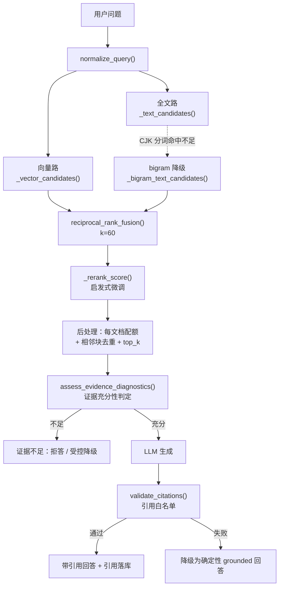
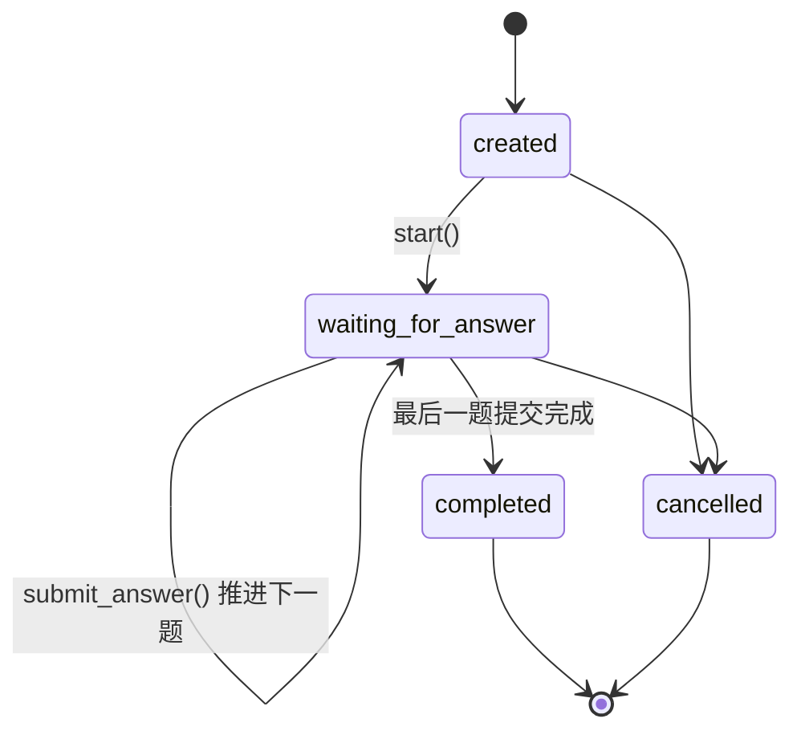

# 01 核心链路与源码地图

> **怎么用**：打开 IDE，跟着本文从入口 API 逐跳跳到 Service、领域规则和持久化模型。目标不是背代码，而是**看到需求知道落在哪条链路，被问实现能说出模块、入口和关键约束**。
> **配套**：开场话术和红线卡看 `00`；被追问时的故事和弹药看 `02`。
> **状态标记**：🟢 已实现且默认启用 ｜ 🟡 已实现但默认关闭 / eval-only ｜ ⚪ 未实现
> **代码引用格式**：`文件路径 → 类/函数 → 作用`，不写行号。

---

## 0. 系统地图

### 0.1 分层职责（一句话版）

| 层 | 目录 | 一句话职责 | 不该做什么 |
|---|---|---|---|
| API | `src/agent_mentor/api/` | 协议转换、参数校验、错误码映射 | 不承载业务规则 |
| Application | `src/agent_mentor/application/` | **编排中心**：事务、幂等、降级、跨模块串联 | 不实现纯算法 |
| Domain | `src/agent_mentor/domain/` | 纯函数规则引擎（状态机、评分判定、画像更新） | 不依赖框架、数据库、Web |
| Ports | `src/agent_mentor/ports/` | Protocol 契约，隔离 LLM / Embedding / 检索 | 不含实现 |
| Infrastructure | `src/agent_mentor/infrastructure/` | 契约实现：数据库、LLM 网关、Embedding、检索适配器 | 不决定业务状态 |
| 支撑模块 | `src/agent_mentor/rag/`、`workflows/` | 解析分块与检索算法、面试节点规格 | 不做编排 |

**装配点（所有依赖在这里注入）**：`src/agent_mentor/main.py` → `create_app()` → 按 `Settings` 选择 Embedding provider、构造 LLM 网关、装配各 Service。

### 0.2 主干数据模型（只保留能讲故事的部分）

```text
知识域
  knowledge_bases ──→ source_documents ──→ knowledge_chunks
                                 └──→ ingestion_jobs（入库任务状态）
                        （辅助）knowledge_catalog_points ──→ knowledge_catalog_sources

面试域
  interview_sessions ──→ interview_questions ──→ user_answers
                                            └──→ interview_followups（每题最多一条）
                     └──→ workflow_checkpoints（append-only 轨迹）

评分与长期记忆
  user_answers ──→ evaluations ──→ profile_update_events（幂等审计）
                                ├──→ ability_profiles（topic / subtopic 两层）
                                ├──→ error_patterns
                                └──→ review_tasks（复习任务）
  evaluations ──→ interview_reports（逐题报告）
```

**关系的读法**：`evaluations` 是唯一的交汇点 —— 它上游绑定 `user_answers`（谁答的什么），下游是画像三条支线（能力 / 错误 / 复习），并且通过 `profile_update_events` 记录"这次评分到底有没有被应用、为什么"。

---

## 1. 链路一 · 文档入库与索引

### 1.1 流程

```text
上传文件 → 扩展名/大小校验 → SHA-256 内容哈希
  → 命中重复？→ 直接返回已有文档
  → 同名但内容变化？→ 旧版本 is_active=false，version+1
  → 落盘 → 建 ingestion_job（pending）
  → 后台 worker 取任务 → 解析（md/txt/pdf/docx）
  → 按标题路径 + 长度切分 → 批量 Embedding
  → 按 chunk_index 原位 upsert → 多余旧 chunk 置 is_active=false
  → 重建 search_text（tsvector）→ 同步知识覆盖目录 → status=ready
```

### 1.2 代码定位五件套

```text
入口 API：       src/agent_mentor/api/knowledge.py → POST /knowledge-bases/{id}/documents
编排 Service：   src/agent_mentor/application/knowledge_service.py
                 → KnowledgeService.add_document()（去重/版本/落盘）
                 → enqueue_ingestion()（建任务）
                 → process_ingestion_queue()（拉取并执行）
                 → ingest()（解析→切分→嵌入→写库→重建索引→同步目录）
核心领域规则：   src/agent_mentor/rag/documents.py → DocumentParser.parse()（解析与标题层级）
                 src/agent_mentor/rag/chunking.py → chunk_sections()（滑动窗口分块 + overlap）
                 src/agent_mentor/domain/knowledge.py → DocumentStatus / IngestionJobStatus / TrustLevel
关键持久化模型：SourceDocumentModel、KnowledgeChunkModel、IngestionJobModel
出问题先看：     source_documents.status 与 ingestion_jobs.status（pending/processing/ready/failed）
                 → 再看 content_hash 是否被去重命中 → 再看 chunk 数量与 is_active
```

### 1.3 为什么这样设计

- **内容哈希去重 + 同名版本化**：重传同一份资料不应该产生新知识，改内容则新建版本并让旧版本退出检索，而不是覆盖历史（历史题目和评分还引用着旧 chunk）。
- **按 `chunk_index` 原位更新**：重建索引时保留 chunk ID，否则历史 `question_references` 和 `evaluation_references` 会全部悬空。
- **入库任务持久化 + 启动扫描**：文档入库是慢操作，放在后台执行；进程中断后由启动扫描把长期滞留的任务标成可重试失败，而不是永久卡在 `processing`。
- **知识覆盖目录**：把"文档里有哪些知识点"抽成稳定目录，才能区分**"没考到"**和**"考了但不会"** —— 这是画像可信度的前提。

（相关文档：`docs/design/V1实现规格说明.md`、`docs/interview/AgentMentor-V2-面试视角结构化复盘.md` §文档链路）

### 1.4 面试官最可能追问

| 追问 | 回答要点 |
|---|---|
| "为什么不用 Celery / 消息队列？" | 当前是单机个人项目，`BackgroundTasks` + 任务表 + 启动扫描已经满足可重试与可观测；不足是**没有租约和中间续跑**，这是明确边界，生产化才需要独立 worker。 |
| "重新索引会不会破坏历史数据？" | 不会。按 `chunk_index` 原位更新并保留 chunk ID，引用链路不受影响。 |
| "标题层级怎么用？" | 解析时保留 `heading_path`，既进分块元数据，也用于从标题路径生成知识目录；并且当文档有二级标题时，一级标题只当主题容器，不当作子知识点。 |

---

## 2. 链路二 · RAG 问答（检索 → 证据门禁 → 引用 → 拒答）

### 2.1 流程



### 2.2 代码定位五件套

```text
入口 API：       src/agent_mentor/api/chat.py → POST /knowledge-bases/{id}/ask
                 （另有 /ask/stream 走 SSE，/retrieve 只返回候选）
编排 Service：   src/agent_mentor/application/answer_service.py
                 → AnswerService.answer()（检索→判证→生成→校验→落库）
                 → AnswerService.assess_evidence_diagnostics()（证据判定与诊断）
核心领域规则：   src/agent_mentor/rag/retrieval.py
                 → normalize_query()（查询归一化）
                 → reciprocal_rank_fusion()（RRF 融合，rrf_k=60）
                 → validate_citations()（引用白名单）
                 → EvidenceContext.render_for_prompt()（把候选渲染成带编号的证据块）
                 src/agent_mentor/domain/evidence.py → EvidenceGatePolicy（两档策略）
检索适配器：     src/agent_mentor/infrastructure/retriever.py → PostgresHybridRetriever.retrieve()
关键持久化模型：ChatSessionModel、ChatMessageModel（含 retrieval_diagnostics）、ChatCitationModel
出问题先看：     响应里的 evidence_sufficient / generation_mode / fallback_reason 三个字段
                 → 再看向量路与全文路各自召回了什么（诊断快照已落库）
```

### 2.3 为什么这样设计

- **两路检索 + RRF 而不是单路**：全文检索擅长类名、术语、精确片段；向量检索擅长语义近似。RRF 只用**排名**融合，不依赖两路分数可比性，工程上更稳。
- **每文档配额 + 相邻块去重是必要后处理**：否则一篇长文档的连续 chunk 会把 Top-K 占满，用户拿不到多来源证据。消融数据显示漏召回主要死在这一步（见 `02` 故事二）。
- **证据门禁独立于检索分数**：检索分高只说明"语义近"，不等于"能支持这个问题"。所以先按词面支持过滤候选，再看受支持候选的最高分是否达阈值。
- **引用白名单是硬约束**：模型只能引用本次上下文里的 chunk；编造引用会触发降级，而不是把错误引用渲染给用户。
- **降级而不是硬失败**：LLM 不可用、输出非法、引用越界，都有确定性 grounded 回答兜底，保证系统始终可用。

### 2.4 面试官最可能追问

| 追问 | 回答要点 |
|---|---|
| "为什么不用 reranker 模型？" | 当前用轻量启发式重排（向量/全文/词面重叠加权）控制本地资源；reranker 通过 `KnowledgeRetriever` 端口可以替换进来，属于演进方向（⚪ 未实现）。 |
| "证据不足的阈值怎么定的？" | 默认 `retrieval_min_score` 是生产配置值，不是占位值；调整需要走冻结数据集 + 预声明协议，不能凭感觉调。 |
| "拒答会不会影响体验？" | 会，所以这是产品取舍：在训练场景里"错答"比"少答"代价更高。前端也提供显式开启模型知识补充的入口，但要标注来源。 |
| "中文没有分词怎么办？" | 全文侧用 `simple` 配置，不宣称有生产级中文 BM25；对 CJK 查询走 bigram 降级匹配，同时靠向量侧补语义。这是明确边界。 |

---

## 3. 链路三 · 模拟面试（创建 → 状态机 → checkpoint → 幂等 → 受控追问）

### 3.1 状态机与流程



```text
创建面试（主题/难度/题数/可选画像路由键）
  → start()：写 load_profile、plan_interview checkpoint，状态 created → waiting_for_answer
  → 生成第 1 题：检索证据 → 生成题目 + 参考答案 + Rubric（含覆盖查漏与近期题冷却）
  → 人机中断（等待用户回答，刷新页面可恢复）
  → 提交答案：幂等校验 → 状态校验 → 落 user_answers
      → 判断是否追问（门禁：回答质量 + 置信度 + 该题未追问）
      → 推进下一题 或 置 completed
```

### 3.2 代码定位五件套

```text
入口 API：       src/agent_mentor/api/interviews.py
                 → POST /interviews（创建）、POST /interviews/{id}/start（启动）
                 → POST /interviews/{id}/answers（主答案，需要 Idempotency-Key）
                 → POST /interviews/{id}/follow-ups/{fid}/answers（追问答案）
                 → GET /interviews/{id}/workflow-trace（轨迹）、/events（SSE）
编排 Service：   src/agent_mentor/application/interview_service.py
                 → create_interview()（建会话）
                 → start()（状态迁移 + 起始 checkpoint）
                 → submit_answer()（幂等 + 状态校验 + 推进）
                 → _maybe_create_follow_up()（追问门禁决策）
                 → submit_follow_up_answer()（追问答案落库）
核心领域规则：   src/agent_mentor/domain/interview.py
                 → ALLOWED_STATUS_TRANSITIONS（合法迁移表）
                 → assert_transition()（非法迁移直接报错）
工作流节点：     src/agent_mentor/workflows/interview.py
                 → WORKFLOW_NODE_SPECS（9 个节点的名称/事件/标签）
                 → checkpoint_summary()（给前端和 SSE 用的摘要）
关键持久化模型：InterviewSessionModel、InterviewQuestionModel、UserAnswerModel、
                 InterviewFollowUpModel、WorkflowCheckpointModel
出问题先看：     session.status 与 current_question_index → 幂等键是否重复
                 → workflow_checkpoints 轨迹看卡在哪个节点
```

### 3.3 为什么这样设计

- **必须人机中断**：三题面试跨越多次 HTTP 请求，中间会刷新页面、断网、重复点击。所以状态必须持久化，而不是放在内存里。
- **每一步的关键状态转换写 checkpoint**：checkpoint 是 append-only 轨迹，用于**恢复证据、排障和展示**；但要说清它**不能**做什么 —— 不能任意续跑、没有任务租约、没有节点级补偿，恢复动作实际由服务层根据数据库状态执行。
- **幂等三层**：前端复用同一幂等键（防重复点击）→ 服务端先查已有答案（友好返回）→ 数据库唯一约束 `uq_answer_idempotency`（并发最终防线）。三者不在同一层，缺一不可。
- **追问受控而不是自主**：是否追问由门禁规则决定（回答质量、置信度、该题是否已追问），模型只负责生成追问内容。这保证追问不会绕过状态机和写入边界。

（相关文档：`docs/interview/AgentMentor-V2-项目掌握与源码走读手册.md` §面试链路）

### 3.4 面试官最可能追问

| 追问 | 回答要点 |
|---|---|
| "为什么不用 LangGraph？" | 节点本来就是按图节点的形态设计的（纯函数、输入 state 输出 state），边由 Service 调用顺序显式表达。当前规模自研更可控；LangGraph 适合节点更多、分支更复杂的场景。**不要说"我这就是 LangGraph"**。 |
| "checkpoint 能恢复吗？" | 能提供恢复证据和轨迹，但恢复动作由服务层根据会话与答案状态执行，不是从 checkpoint 重放。边界必须讲清。 |
| "并发两个请求同时提交？" | 可能同时通过预查询，但唯一约束是最终防线：捕获冲突后回滚并返回既有快照，不重复推进。 |
| "追问为什么每题只有一次？" | 受控设计：单场面试题数固定，追问是"补一刀"而不是无限对话；无限追问会让评分和状态机都失控。 |

---

## 4. 链路四 · 评分 → 画像 → 复习任务闭环

### 4.1 流程（用表表达，不画图）

| 阶段 | 输入 | 处理 | 输出/落库 |
|---|---|---|---|
| 1. 逐题评分 | 题目 + Rubric + 参考答案 + 用户回答 + 引用证据 | LLM 只产出四维分数与结构化信号；**应用层重算总分**并校验 Rubric 与引用白名单 | `evaluations` + `evaluation_references` |
| 2. 复核路由 | 评分结果 + confidence | 按规则判定：无需复核 → `final`；需要复核但复核人不可用 → `review_pending`；复核后分歧过大 → `disputed` | `evaluations.status` |
| 3. 生成报告 | 该场全部评分 | 汇总总分/维度/知识点小结/错误摘要/下一步建议 | `interview_reports` |
| 4. 画像更新 | 可信 evaluation | 先判是否允许更新；允许则按 EMA 渐进更新 topic 与 subtopic 掌握度 | `ability_profiles` + `profile_update_events` |
| 5. 错误与复习 | 低分且定位到最弱维度 | 归类错误类型 → upsert 复习任务（重复出现则提优先级、重置验证 streak） | `error_patterns` + `review_tasks` |
| 6. 复习闭环 | 后续可信高分 | 连续验证进度累积，达到阈值才把任务置为完成 | `review_tasks.status` |
| 7. 反哺选题 | 未完成复习任务 + 低掌握能力 + 覆盖缺口 | 生成训练焦点列表，**由用户确认后**作为下一场面试主题 | `GET .../training-focuses` |

### 4.2 代码定位五件套（评分与报告）

```text
入口 API：       src/agent_mentor/api/evaluations.py
                 → POST /interviews/{id}/evaluations、POST /interviews/{id}/report
                 → GET /knowledge-bases/{id}/reports/history、/reports/trends
编排 Service：   src/agent_mentor/application/evaluation_service.py
                 → evaluate_interview()（逐题评分，幂等跳过已有评分）
                 → _evaluate_answer()（单题评分 + 复核路由 + 引用校验）
                 → build_report()（事务内 upsert 报告）
                 → score_trends()（多轮趋势）
核心领域规则：   src/agent_mentor/domain/evaluation.py
                 → total_score()（应用层重算总分，不信模型给的 total）
                 → review_reasons_for()（触发复核的规则集）
                 → initial_review_route()（final / review_pending / used_review）
                 → EvaluationRubric（权重和必须为 100）
关键持久化模型：EvaluationModel、EvaluationReferenceModel、InterviewReportModel
出问题先看：     evaluation.status 与 confidence → review_reasons 里写了什么
                 → 引用白名单是否拒绝了模型给的 chunk
```

### 4.3 代码定位五件套（画像与复习）

```text
入口 API：       src/agent_mentor/api/profiles.py
                 → POST /interviews/{id}/profile-updates（用评分回写画像）
                 → GET /knowledge-bases/{id}/profile/abilities、/profile/error-patterns
                 → GET /knowledge-bases/{id}/review-tasks、/training-focuses、/coverage、/interview-plan
编排 Service：   src/agent_mentor/application/profile_service.py
                 → apply_interview_evaluations()（按 evaluation 幂等推进画像）
                 → training_focuses()（训练焦点）
                 → recommend_interview_plan()（下一轮推荐）
                 → get_coverage()（覆盖状态）
                 → complete_review_task()（手动完成复习任务，幂等）
核心领域规则：   src/agent_mentor/domain/profile.py
                 → profile_update_decision()（决定是否更新、用什么权重）
                 → updated_mastery()（EMA 渐进更新掌握度）
                 → classify_error()（最弱维度 → 错误类型）
                 → next_review_due()（按出现次数排下次复习时间）
                 → review_verification_progress()（连续验证进度）
                 → rank_training_focuses()（训练焦点排序）
关键持久化模型：AbilityProfileModel、ErrorPatternModel、ReviewTaskModel、ProfileUpdateEventModel
出问题先看：     profile_update_events 里是否 applied=false、decision 写的是什么原因
                 → review_tasks.verification_streak 是否在累积
```

### 4.4 为什么这样设计

- **LLM 不决定最终分数**：模型只提供四个维度的分数和结构化信号，**总分由应用层重算**，保证四维之和与总分严格一致，也防止模型"自由发挥"一个总分。
- **评分与画像解耦**：评分可以重跑（幂等跳过已有），但画像更新必须**每个 evaluation 只应用一次**，靠 `ProfileUpdateEventModel` 的唯一约束和 `applied` 标记保证。
- **不可信评分不污染长期记忆**：`disputed` 和 `review_pending` 直接不更新；低置信但 `final` 的降权更新。
- **掌握度与覆盖度分离**：上传新资料只会往目录里增加 `uncovered` 的知识点，**不会降低已有掌握度**；只有题目真正引用对应 chunk 且取得可信评分，覆盖状态才推进。
- **复习任务要"连续两次"才算完成**：单次高分可能是题目简单或偶然，连续验证才置为完成。

（相关文档与实测：`docs/evaluations/incremental-document-coverage-acceptance-20260802.md`、`docs/evaluations/training-quality-audit-20260902.md`）

### 4.5 面试官最可能追问

| 追问 | 回答要点 |
|---|---|
| "为什么不信 LLM 给的总分？" | 总分可由应用层严格计算（四维之和），交给模型只会引入不一致；模型的价值在于给出分维度和结构化信号，不在于汇总。 |
| "低置信怎么处理？" | 先走复核路由；如果复核人不可用就是 `review_pending`，此时**不更新画像**。宁可少更新，也不让噪声进入长期记忆。 |
| "新资料导入会不会把分数拉低？" | 不会。实测中导入新文档后主主题掌握度保持不变，只有在真正完成可信评分后才变化。 |
| "画像凭什么代表我的水平？" | 它只是可信评分驱动的渐进估计，不是人才测评。而且画像按知识库隔离，冷启动时有确定性降级路径。 |

---

## 5. 症状 → 第一定位点

> 面试现场被问"线上出问题你怎么查"，或者自己要快速定位时用这张表。

| 现象 | 第一处看哪里 |
|---|---|
| 回答被拒绝 | `src/agent_mentor/application/answer_service.py` → `AnswerService.assess_evidence_diagnostics()`，看 `production_sufficient` 与候选的词法支持 |
| 引用异常 / 编造引用 | `src/agent_mentor/rag/retrieval.py` → `validate_citations()`；再看本次上下文里的候选是否被正确渲染 |
| 检索召回变差 | `src/agent_mentor/infrastructure/retriever.py` → `PostgresHybridRetriever.retrieve()`，看每文档配额与相邻块去重是否过滤过狠 |
| 重复提交 / 重复推进 | `src/agent_mentor/application/interview_service.py` → `InterviewService.submit_answer()`，看预查询与 `uq_answer_idempotency` |
| 未出现追问 | `src/agent_mentor/application/interview_service.py` → `_maybe_create_follow_up()`，看 `should_follow_up`、`confidence`、会话是否 `WAITING_FOR_ANSWER` |
| 画像没有更新 | `src/agent_mentor/domain/profile.py` → `profile_update_decision()`（`disputed`/`review_pending` 不更新），再查 `ProfileUpdateEventModel.applied` |
| 复习任务完不成 | `src/agent_mentor/domain/profile.py` → `review_verification_progress()`，看验证 streak 是否在累积 |
| 文档一直不是 ready | `src/agent_mentor/application/knowledge_service.py` → `process_ingestion_queue()` / `recover_interrupted_ingestions()`；状态看 `IngestionJobModel.status` |
| BGE 未生效 | `GET /health/runtime` → `src/agent_mentor/config.py` → `Settings.embedding_provider` → `src/agent_mentor/main.py` → `create_app()` 的装配分支 |
| 报告与评分不一致 | `src/agent_mentor/application/evaluation_service.py` → `build_report()` 是否在评分之后调用；报告是事务内 upsert，不应先删后建 |

---

## 6. 走读建议顺序

时间有限时按这个顺序跳（约 2 小时）：

1. `src/agent_mentor/main.py` → `create_app()`：先看依赖怎么装配，建立"谁依赖谁"的心智模型
2. `src/agent_mentor/infrastructure/database/models.py`：只看 §0.2 列出的主干表
3. `src/agent_mentor/api/chat.py` → `src/agent_mentor/application/answer_service.py` → `src/agent_mentor/infrastructure/retriever.py`：走通 RAG 链路
4. `src/agent_mentor/api/interviews.py` → `src/agent_mentor/application/interview_service.py` → `src/agent_mentor/domain/interview.py`：走通面试链路
5. `src/agent_mentor/api/evaluations.py` → `src/agent_mentor/application/evaluation_service.py` → `src/agent_mentor/domain/evaluation.py`：走通评分链路
6. `src/agent_mentor/api/profiles.py` → `src/agent_mentor/application/profile_service.py` → `src/agent_mentor/domain/profile.py`：走通画像与复习闭环
